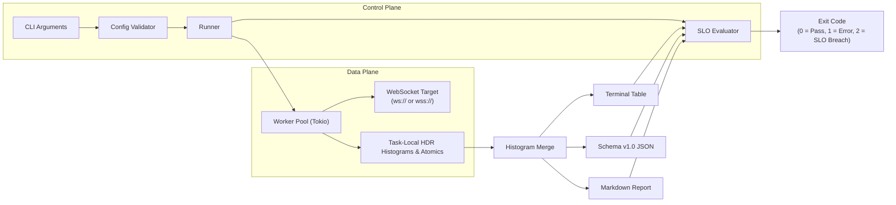

# wsblast

A high-performance WebSocket load testing CLI written in Rust.

* **Fast**: Zero-allocation hot paths and lock-free task-local metrics for maximum throughput.
* **Precise**: Monotonic microsecond latency percentiles (`p50`, `p90`, `p95`, `p99`, `p99.9`) using `HdrHistogram`.
* **CI-First**: Service Level Objective (SLO) gating with exit code `2` on budget breaches and markdown report generation.

[![Crates.io][crates-badge]][crates-url]
[![Build Status][actions-badge]][actions-url]
[![License: MIT OR Apache-2.0][license-badge]][license-url]
[![Downloads][downloads-badge]][crates-url]

[crates-badge]: https://img.shields.io/crates/v/wsblast.svg
[crates-url]: https://crates.io/crates/wsblast
[actions-badge]: https://github.com/jephter-olamiposi/wsblast/actions/workflows/ci.yml/badge.svg
[actions-url]: https://github.com/jephter-olamiposi/wsblast/actions/workflows/ci.yml
[license-badge]: https://img.shields.io/badge/license-MIT%20OR%20Apache--2.0-blue.svg
[license-url]: https://github.com/jephter-olamiposi/wsblast#license
[downloads-badge]: https://img.shields.io/crates/d/wsblast.svg

## Overview

`wsblast` generates concurrent WebSocket load, measures round-trip latency distributions, and evaluates latency and error budgets in CI/CD pipelines.

Key capabilities:
* **Zero-Allocation Hot Path:** Pre-allocated frame buffers (`Utf8Bytes`, `Bytes`) avoid heap allocations in worker loops.
* **Lock-Free Concurrency:** Task-local latency histograms eliminate mutex contention across concurrent workers.
* **Connection Pacing:** Connection ramp rate (`--ramp-rate`) and request pacing (`--rate`) prevent SYN-flood queue drops and thundering-herd issues.
* **Failure Taxonomy:** Distinguishes DNS, TCP, TLS, HTTP 101 Upgrade rejection (`4xx`/`5xx`), protocol violations, timeouts, and unexpected closes.
* **Live Dashboard:** Interactive terminal UI powered by Ratatui with real-time throughput sparklines and active connection counters.
* **Scenario DSL:** Declarative YAML phases with targets, actions, think time, and per-phase pacing.
* **Production Protocols:** GraphQL WS subscriptions and static-token or API-key handshake authentication.
* **CI Gating:** SLO budgets with exit code `2` on a breach, and baseline regression comparison between two JSON reports.
* **Multi-Format Reports:** Generates human-readable terminal tables, machine-readable JSON (schema v1.0), and GitHub Flavored Markdown.

---

## Installation

### Cargo (crates.io)
```bash
cargo install wsblast
```

### Pre-Compiled Binary (macOS & Linux)
Installs the pre-built binary for your OS and CPU architecture into `/usr/local/bin`, after verifying its published SHA-256 checksum:
```bash
curl -fsSL https://raw.githubusercontent.com/jephter-olamiposi/wsblast/main/install.sh | sh
```
Set `WSBLAST_VERSION` (for example `| WSBLAST_VERSION=v0.1.1 sh`) to install a specific release without querying the GitHub API.

### Docker
```bash
docker build -t wsblast .
docker run --rm -it wsblast wss://echo.websocket.org -c 20 -d 10s
```

### Direct Download
Standalone `.tar.gz` and `.zip` packages for Linux (x86_64 & aarch64), macOS (Apple Silicon & Intel), and Windows, each with a `.sha256` checksum, are available on the [Releases](https://github.com/jephter-olamiposi/wsblast/releases) page.

---

## Quick Start

Run a 10-second test with 50 concurrent connections against an echo endpoint:
```bash
wsblast ws://127.0.0.1:9001 -c 50 -d 10s
```

Launch the interactive terminal dashboard (TUI):
```bash
wsblast ws://127.0.0.1:9001 -c 100 -d 30s --tui
```

Enforce latency and error rate budgets:
```bash
wsblast ws://127.0.0.1:9001 -c 50 -d 15s --max-p99 25ms --max-error-rate 0.01
```

---

## Feature Flags

Advanced capabilities are compiled on demand so the core binary stays small. Install everything with:

```bash
cargo install wsblast --features full
```

| Feature | Capability |
| :--- | :--- |
| `scenario` | YAML multi-phase scenarios with per-phase targets, actions, and think time |
| `auth` | Static bearer token and API-key handshake authentication |
| `graphql-ws` | Apollo GraphQL WS `connection_init` / `start` subscriptions |
| `compare` | Baseline/current JSON report regression gates |

`full` enables every feature above.

### Removed in 0.2.0

v0.2.0 ships a smaller crate in which every feature works end to end. Distributed execution, OpenTelemetry and Prometheus export, frame capture, chaos injection, the mock server, JWT and OAuth2 authentication, and the `compression` placeholder were removed. Their last implementation is preserved on the [`archive/v0.1-full-features`](https://github.com/jephter-olamiposi/wsblast/tree/archive/v0.1-full-features) branch, and several of them will return, rebuilt, in later releases. See the [changelog](CHANGELOG.md) for migration notes.

---

## Scenario DSL

Run a validated multi-phase scenario instead of a single fixed load:

```bash
wsblast --scenario examples/scenarios/basic.yaml --no-progress
wsblast --scenario examples/scenarios/basic.yaml --phase sustain
```

A scenario can set a default `target`, override it per phase, and override the CLI URL:

```yaml
version: "1.0"
target: "ws://127.0.0.1:9001"
metadata:
  name: "Warmup and sustain"

phases:
  - name: "warmup"
    duration: "5s"
    connections: 10
    ramp_rate: 5
    rate_per_conn: 50
    payload: '{"seq":{{seq}}}'
    think_time: "10ms"
    actions:
      - type: Send

  - name: "sustain"
    target: "ws://127.0.0.1:9002"
    duration: "30s"
    connections: 50
    rate_per_conn: 100
    actions:
      - type: Send
        count: 5
      - type: Wait
        duration: "100ms"
      - type: Ping
        interval: "2s"
```

Endpoint precedence is **CLI `--url` → phase `target` → scenario `target`**. Supported actions are `Send`, `Wait`, `Ping`, and `Close`; scripts repeat until the phase duration elapses, the run is cancelled, or `Close` executes. `think_time` pauses after each send burst. A scenario may omit its target only when `--url` is supplied.

---

## Authentication

Authentication is resolved once at startup and merged into the WebSocket handshake headers, so every connection and reconnect sends it:

```bash
# Static bearer token
wsblast wss://api.example.com/ws -c 10 -d 30s \
  --auth-type static --auth-token "$TOKEN"

# API key in a custom header
wsblast wss://api.example.com/ws -c 10 -d 30s \
  --auth-type apikey --auth-apikey "$KEY" --auth-apikey-header X-API-Key
```

Tokens are not refreshed mid-run. For tests longer than the token lifetime, provide a token whose expiry covers the whole run.

---

## GraphQL WS

Use the Apollo `graphql-transport-ws` protocol for subscriptions:

```bash
wsblast wss://api.example.com/graphql \
  --mode graphql-ws \
  --subprotocol graphql-transport-ws \
  --graphql-ws-operation 'subscription Prices { prices(symbol: "BTC") }' \
  --graphql-ws-operation-name Prices \
  --graphql-ws-variables '{"symbol":"BTC"}'
```

The worker performs `connection_init`, waits for `connection_ack`, sends `subscribe`, records `next` frames, answers `ping` with `pong`, and terminates on `complete` or `error`. Selecting `--subprotocol graphql-ws` switches to the legacy `start` / `data` / `stop` flow.

---

## Baseline Comparison

Archive a run as JSON, then compare a later run against it:

```bash
wsblast wss://api.example.com/ws -c 50 -d 30s --format json -o baseline.json
wsblast wss://api.example.com/ws -c 50 -d 30s --format json -o current.json

wsblast --compare baseline.json current.json \
  --compare-threshold 10 --fail-on-regression
```

`--fail-on-regression` exits with code `2` when any tracked metric regresses beyond the threshold.

---

## Architecture



---

## Terminal Dashboard (TUI)

Pass `--tui` to launch an interactive live dashboard powered by Ratatui:


---

## Benchmark Report

At completion, `wsblast` renders a percentile latency breakdown and SLO evaluation:


---

## CI/CD Pipeline Integration

`wsblast` returns exit code `2` on SLO breaches, making it suitable for CI/CD performance regression gates.

```yaml
name: Performance Gate

on: [push, pull_request]

jobs:
  websocket-gate:
    runs-on: ubuntu-latest
    steps:
      - uses: actions/checkout@v4

      - name: Install wsblast
        run: curl -fsSL https://raw.githubusercontent.com/jephter-olamiposi/wsblast/main/install.sh | sh

      - name: Run Performance Gate
        run: |
          wsblast wss://staging.example.com/ws \
            -c 50 \
            -d 15s \
            --max-p99 30ms \
            --max-error-rate 0.005 \
            --format markdown \
            --no-progress \
            -o report.md

      - name: Attach Summary to PR
        if: always()
        run: cat report.md >> $GITHUB_STEP_SUMMARY
```

---

## Command-Line Reference

```text
wsblast [OPTIONS] [URL]
```

### Core Options

| Option | Default | Description |
| :--- | :--- | :--- |
| `URL`, `-u, --url` | *Required* | Target WebSocket endpoint (`ws://` or `wss://`) |
| `-c, --connections` | `50` | Number of concurrent WebSocket connection workers |
| `--ramp-rate` | `0` | Connection ramp rate in workers/sec (`0` = unthrottled burst). The ramp counts toward `--duration`; if it needs longer than the duration, a warning is printed and not every connection opens |
| `-d, --duration` | `10s` | Total wall-clock test duration including the ramp-up (e.g. `10s`, `30s`, `2m`, `500ms`) |
| `-n, --requests` | `None` | Total message limit across all workers |
| `-r, --rate` | `0` | Message rate per connection per second (`0` = unthrottled) |
| `-p, --payload` | JSON payload | Inline text payload (supports `{{timestamp}}`, `{{worker_id}}`, `{{seq}}`) |
| `--payload-file` | `None` | Path to file containing payload |
| `--binary` | `false` | Send payload as binary frames instead of text |
| `-H, --header` | `None` | Custom HTTP header (e.g. `-H "Authorization: Bearer token"`) |
| `--subprotocol` | `None` | WebSocket subprotocol (e.g. `graphql-transport-ws`) |
| `--mode` | `echo` | Execution mode: `echo` (RTT round-trip), `stream` (dispatch-only), `listen`, `graphql-ws` |
| `--connect-timeout` | `5s` | Timeout for establishing TCP+TLS+WS upgrade handshake |
| `--message-timeout` | `5s` | Per-message response timeout in echo mode |
| `--match` | `first` | How echo mode recognises a reply: `first` (the first data frame after a send), `exact` (byte-identical to the request) or `json:<pointer>` (JSON value at the pointer equals the request's `{{seq}}`). See [How replies are matched](#how-replies-are-matched) |
| `--ping-interval` | `0s` | Heartbeat ping interval (`0s` = disabled) |
| `--no-reconnect` | `false` | Stop a worker after a timeout, I/O error or server close instead of reconnecting (backoff 100ms doubling to 5s) |
| `--tui` | `false` | Launch interactive terminal dashboard |
| `--format` | `text` | Output report format: `text`, `json`, `markdown` |
| `-o, --output` | `None` | File path to write report output |
| `--no-progress` | `false` | Suppress progress bar (recommended for CI logs) |

### How replies are matched

In echo mode each worker sends one request and waits for its reply before sending the next, and the RTT runs from the send to that reply. `--match` decides which inbound frame counts as the reply:

- `first` (default): the first text or binary frame received after the send is the reply. This is the cheapest rule and is exact against a plain echo server, but a server that also pushes unsolicited frames (broadcasts, heartbeats, presence updates) gets those frames recorded as replies with a too-short RTT, and the real reply is then credited to the next request.
- `exact`: the reply must be byte-identical to the request frame, of the same frame type. Use it with servers that echo verbatim but also push other traffic.
- `json:<pointer>`: the reply is parsed as JSON and the value at the [RFC 6901](https://www.rfc-editor.org/rfc/rfc6901) pointer must equal the request's `{{seq}}`, given as a JSON number or a numeric string. For example `--payload '{"op":"ping","id":{{seq}}}' --match json:/id` matches replies such as `{"op":"pong","id":"42"}`. The payload must contain `{{seq}}`.

With `exact` and `json:<pointer>`, frames that do not match are counted as `total_unsolicited_frames` (shown in the text and Markdown reports when non-zero) and the worker keeps waiting for its reply until `--message-timeout`, after which the usual timeout and reconnect handling applies. A non-default `--match` requires `--mode echo`, and `json:<pointer>` without `{{seq}}` in every payload (including scenario phase and action payloads) or with an invalid pointer is rejected at startup.

### Scenario Options

| Option | Description |
| :--- | :--- |
| `--scenario <FILE>` | YAML scenario definition; conflicts with per-run sizing/payload flags |
| `--phase <NAME>` | Execute only the named scenario phase |
| `--url` | Overrides phase and scenario targets when supplied |

### Authentication Options

| Option | Description |
| :--- | :--- |
| `--auth-type <TYPE>` | `none`, `static`, or `apikey` |
| `--auth-token <TOKEN>` | Static token; `Authorization` values gain a `Bearer ` prefix when absent |
| `--auth-header <HEADER>` | Header for a static token (default `Authorization`) |
| `--auth-apikey <KEY>` | API key value |
| `--auth-apikey-header <HEADER>` | API-key header (default `X-API-Key`) |

### GraphQL WS Options

| Option | Description |
| :--- | :--- |
| `--graphql-ws-operation <QUERY>` | GraphQL query/mutation/subscription text |
| `--graphql-ws-operation-name <NAME>` | Operation name |
| `--graphql-ws-variables <JSON>` | Variables object |
| `--graphql-ws-extensions <JSON>` | Extensions object |

### Comparison Options

| Option | Description |
| :--- | :--- |
| `--compare <BASELINE> <CURRENT>` | Compare two JSON reports |
| `--compare-threshold <PERCENT>` | Regression threshold (default `10`) |
| `--fail-on-regression` | Exit `2` when the comparison detects a regression |

### SLO Gating Options

| Option | Description |
| :--- | :--- |
| `--max-p50 <DURATION>` | Maximum acceptable p50 (median) round-trip latency (e.g. `5ms`, `500us`) |
| `--max-p95 <DURATION>` | Maximum acceptable p95 round-trip latency (e.g. `20ms`) |
| `--max-p99 <DURATION>` | Maximum acceptable p99 round-trip latency (e.g. `50ms`) |
| `--max-p999 <DURATION>` | Maximum acceptable p99.9 round-trip latency (e.g. `100ms`) |
| `--max-error-rate <FLOAT>` | Maximum acceptable error rate fraction (e.g. `0.01` for 1%) |
| `--min-throughput <RPS>` | Minimum required message throughput (messages/sec) |

Latency budgets apply to round-trip time, which only `--mode echo` measures; other modes reject them at startup. A latency check with no measured round trips (for example, every request timed out) fails rather than passing on an empty histogram.

---

## Exit Codes

| Code | Status | Description |
| :--- | :--- | :--- |
| `0` | **Success** | Test completed successfully and all configured SLO thresholds passed. |
| `1` | **Failure** | Runtime error (unreachable host, invalid configuration, fatal I/O error) or invalid command-line arguments (unknown flag, missing value, conflicting flags). |
| `2` | **SLO Breach** | Benchmark completed, but one or more SLO thresholds were violated. Only an SLO breach or a `--compare --fail-on-regression` regression exits with `2`. |

---

## License

Licensed under either of

* Apache License, Version 2.0 ([LICENSE-APACHE](LICENSE-APACHE) or <https://www.apache.org/licenses/LICENSE-2.0>)
* MIT license ([LICENSE-MIT](LICENSE-MIT) or <https://opensource.org/licenses/MIT>)

at your option.

### Contribution

Unless you explicitly state otherwise, any contribution intentionally submitted
for inclusion in wsblast by you, as defined in the Apache-2.0 license, shall be
dual licensed as above, without any additional terms or conditions.
