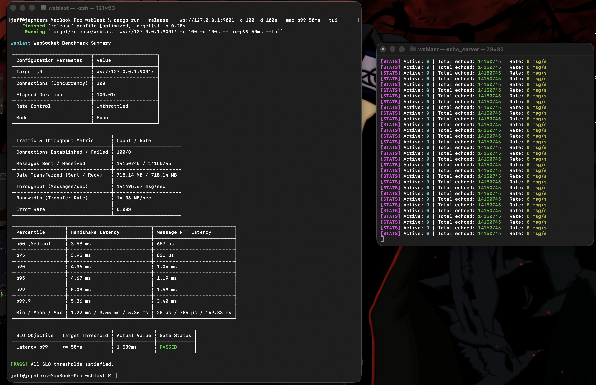
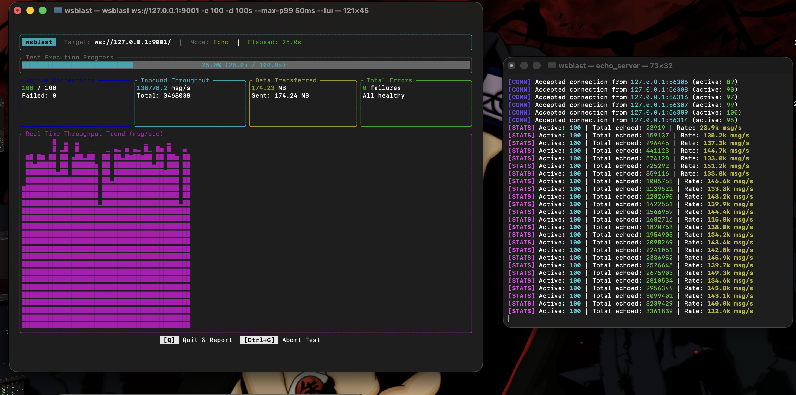

# wsblast

A WebSocket load-testing tool and library for Rust. It measures latency as
HDR percentiles, corrects for coordinated omission, and gates CI pipelines on
SLOs.

[![Crates.io][crates-badge]][crates-url]
[![Documentation][docs-badge]][docs-url]
[![MIT/Apache-2.0 licensed][license-badge]][license-url]
[![Build Status][ci-badge]][ci-url]
[![MSRV][msrv-badge]](#supported-rust-versions)

[crates-badge]: https://img.shields.io/crates/v/wsblast.svg
[crates-url]: https://crates.io/crates/wsblast
[docs-badge]: https://img.shields.io/docsrs/wsblast
[docs-url]: https://docs.rs/wsblast
[license-badge]: https://img.shields.io/badge/license-MIT%2FApache--2.0-blue.svg
[license-url]: https://github.com/jephter-olamiposi/wsblast#license
[ci-badge]: https://github.com/jephter-olamiposi/wsblast/actions/workflows/ci.yml/badge.svg
[ci-url]: https://github.com/jephter-olamiposi/wsblast/actions/workflows/ci.yml
[msrv-badge]: https://img.shields.io/badge/MSRV-1.88-blue.svg

[API Docs][docs-url] |
[CLI Reference](https://github.com/jephter-olamiposi/wsblast/blob/main/docs/cli.md) |
[Methodology](https://github.com/jephter-olamiposi/wsblast/blob/main/METHODOLOGY.md) |
[Changelog](https://github.com/jephter-olamiposi/wsblast/blob/main/CHANGELOG.md)

## Overview

wsblast opens WebSocket connections to a server, sends traffic through them,
and reports latency, throughput and errors. The exit code tells a CI job
whether the server met its SLOs. At a high level, it provides:

* **Exact percentiles**: latency is recorded in HDR histograms per connection
  and merged, never averaged, from p50 to p99.9, across connections and
  across machines.
* **Coordinated omission correction**: paced runs measure response time from
  when each request was due, so a server stall counts against every request
  that waited behind it.
* **A failure taxonomy**: errors are counted by cause, from DNS and TLS to
  rejected upgrades, timeouts and unexpected closes.
* **SLO gates for CI**: exit code `2` is reserved for a failed SLO or a
  regression against a baseline report.
* **Time series**: every report breaks the run down by interval, so a stall
  shows up where it happened instead of in the run's averages.
* **Distributed load**: `wsblast agent` on several machines generates one run's
  load, with histograms merged exactly on the coordinator.
* **Test tooling**: a mock server that can misbehave on purpose or answer
  from a rules file,
  multi-phase YAML scenarios, client-side fault injection, frame capture,
  Prometheus and OpenTelemetry export, HTML reports and a live terminal
  dashboard.



## Example

Install the command-line tool:

```bash
cargo install wsblast
```

Run 50 connections for 10 seconds against an echo endpoint:

```bash
wsblast ws://127.0.0.1:9001 -c 50 -d 10s
```

Gate on the result: exit with `2` if p99 exceeds 25 ms or more than 1% of
operations fail.

```bash
wsblast ws://127.0.0.1:9001 -c 50 -d 15s --max-p99 25ms --max-error-rate 0.01
```

Shape the load with stages: ramp to 200 connections over 30 seconds, hold for
2 minutes at 10 messages per second each, then ramp down.

```bash
wsblast ws://127.0.0.1:9001 --stages 30s:200,2m:200,30s:0 -r 10
```

`wsblast mock` starts a local echo server on `127.0.0.1:9001` to test against.
With `--delay 20ms --stall-every 5s --stall-for 300ms` it answers slowly and
stalls every 5 seconds. Add `--tui` to any run for the live dashboard.



### In CI

```yaml
- name: WebSocket SLO gate
  run: |
    curl -fsSL https://raw.githubusercontent.com/jephter-olamiposi/wsblast/main/install.sh | sh
    wsblast "$WS_URL" -c 50 -d 30s -r 20 \
      --max-p99 50ms --max-error-rate 0.01 \
      --no-progress --format markdown -o report.md
- name: Job summary
  if: always()
  run: cat report.md >> "$GITHUB_STEP_SUMMARY"
```

The report is written before wsblast exits, also when the gate fails.

| Exit code | Meaning |
| :--- | :--- |
| `0` | The run completed, every SLO passed and at least one connection was established. |
| `1` | Invalid arguments, a configuration or runtime error, or every connection failed. |
| `2` | An SLO failed, or `--fail-on-regression` found a regression. |

### As a library

The engine behind the command line is a library. Add it to your
`Cargo.toml`:

```toml
[dependencies]
wsblast = "0.2"
tokio = { version = "1", features = ["macros", "rt-multi-thread"] }
```

Then run a load test and gate on it in code:

```rust,no_run
use std::time::Duration;
use wsblast::{LoadTestConfig, Runner, SloThresholds, evaluate_slos};

#[tokio::main]
async fn main() -> wsblast::Result<()> {
    let config = LoadTestConfig::builder("ws://127.0.0.1:9001/ws")
        .connections(10)
        .duration(Duration::from_secs(5))
        .rate_per_connection(20)
        .slo(SloThresholds::new().with_max_p99(Duration::from_millis(25)))
        .build()?;

    let metrics = Runner::new(config.clone())
        .with_signal_handling(false)
        .run()
        .await?;
    println!("p99 response time: {:?}", metrics.response_time.p99_duration());

    let gate = evaluate_slos(config.slo(), &metrics);
    if !gate.passed {
        std::process::exit(2);
    }
    Ok(())
}
```

The builder applies the same validation as the command line, and the metrics
are the ones the CLI reports. See the [API documentation][docs-url] for the
full interface.

## Installation

```bash
cargo install wsblast         # build from source
cargo binstall wsblast        # download a pre-built binary
curl -fsSL https://raw.githubusercontent.com/jephter-olamiposi/wsblast/main/install.sh | sh
```

Pre-built binaries for Linux, macOS and Windows are on the
[releases page](https://github.com/jephter-olamiposi/wsblast/releases). The
shell installer verifies the archive's SHA-256 checksum and installs to
`/usr/local/bin`, or to `~/.local/bin` without sudo; set `WSBLAST_INSTALL_DIR`
to choose another directory. No Docker image is published, but the repository
builds one:

```bash
docker build -t wsblast https://github.com/jephter-olamiposi/wsblast.git
```

## Feature flags

| Feature | Default | Enables |
| :--- | :--- | :--- |
| `scenario` | yes | Multi-phase YAML scenarios with per-phase SLOs and stages |
| `compare` | yes | `--compare` and `--fail-on-regression` against a baseline report |
| `auth` | yes | Bearer token and API key authentication, including tokens from a command |
| `graphql-ws` | yes | GraphQL subscriptions over `graphql-transport-ws` and legacy `graphql-ws` |
| `prometheus` | yes | A live `/metrics` endpoint for the duration of a run |
| `capture` | yes | A JSON Lines record of every frame and connection event |
| `mock` | yes | `wsblast mock`, a local test server with configurable faults and scripted replies |
| `distributed` | yes | `wsblast agent` and `--agents` for load from several machines |
| `chaos` | yes | Client-side fault injection that does not skew the measurements |
| `otel` | no | Export to an OpenTelemetry collector over OTLP/HTTP |
| `jwt` | no | JSON Web Tokens signed by wsblast, re-signed before expiry |
| `oauth2` | no | OAuth 2.0 client-credentials tokens, refreshed before expiry |

`cargo install wsblast` and the release binaries include the default
features; add the others with, for example, `--features otel,jwt,oauth2`.
Library users can depend on `wsblast` with `default-features = false` and
enable only what they need.

## Documentation

* [CLI reference](https://github.com/jephter-olamiposi/wsblast/blob/main/docs/cli.md):
  options grouped by purpose, and exit codes.
* [Methodology](https://github.com/jephter-olamiposi/wsblast/blob/main/METHODOLOGY.md):
  how every number in a report is measured, and the known limitations.
* [CI recipes](https://github.com/jephter-olamiposi/wsblast/blob/main/docs/ci.md):
  GitHub Actions, GitLab CI, baseline comparison and HTML reports.
* [Scenarios](https://github.com/jephter-olamiposi/wsblast/blob/main/docs/scenarios.md):
  multi-phase load with actions, think time and per-phase SLOs.
* [Distributed runs](https://github.com/jephter-olamiposi/wsblast/blob/main/docs/distributed.md):
  running agents and a coordinator, securely.
* [Live export](https://github.com/jephter-olamiposi/wsblast/blob/main/docs/export.md):
  Prometheus and OpenTelemetry.
* [Templates and test data](https://github.com/jephter-olamiposi/wsblast/blob/main/docs/templates.md):
  placeholders, and a data file that gives every connection its own values.
* [Mock server](https://github.com/jephter-olamiposi/wsblast/blob/main/docs/mock.md):
  testing a gate against known failures, and scripted replies.
* [Benchmarks](https://github.com/jephter-olamiposi/wsblast/blob/main/docs/benchmarks.md):
  throughput per core, memory per connection and a server stall, compared
  with k6 and Artillery.

## Getting Help

Questions and bug reports go to the
[issue tracker](https://github.com/jephter-olamiposi/wsblast/issues). Please
report security problems privately, as described in
[SECURITY.md](https://github.com/jephter-olamiposi/wsblast/blob/main/SECURITY.md).

## Contributing

Contributions are welcome. The
[contributing guide](https://github.com/jephter-olamiposi/wsblast/blob/main/CONTRIBUTING.md)
covers the development setup, the checks CI runs and how to propose a change.

## Supported Rust Versions

wsblast's minimum supported Rust version is 1.88. CI checks that the library
and the binary build with it, with no features, the default features, and the
opt-in `otel` and `jwt` features. Raising it
happens in a minor release and is noted in the changelog, never in a patch
release.

## License

Licensed under either of

* Apache License, Version 2.0
  ([LICENSE-APACHE](https://github.com/jephter-olamiposi/wsblast/blob/main/LICENSE-APACHE))
* MIT license
  ([LICENSE-MIT](https://github.com/jephter-olamiposi/wsblast/blob/main/LICENSE-MIT))

at your option.

### Contribution

Unless you explicitly state otherwise, any contribution intentionally submitted
for inclusion in wsblast by you, as defined in the Apache-2.0 license, shall be
dual licensed as above, without any additional terms or conditions.
