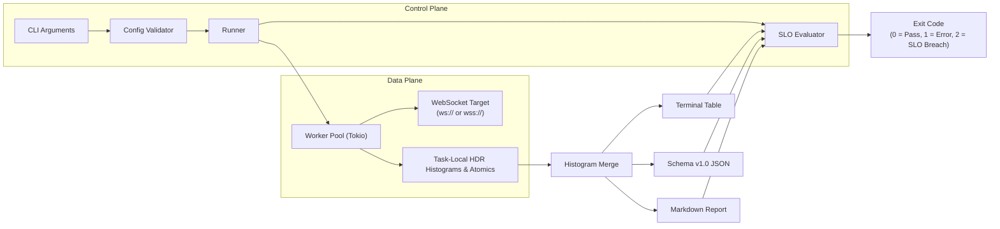
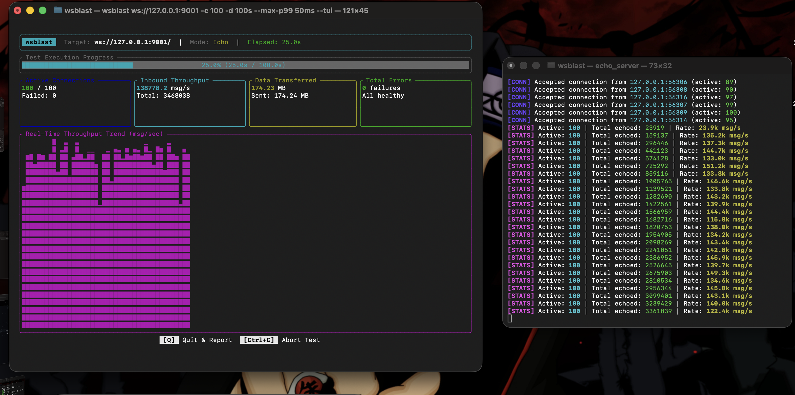
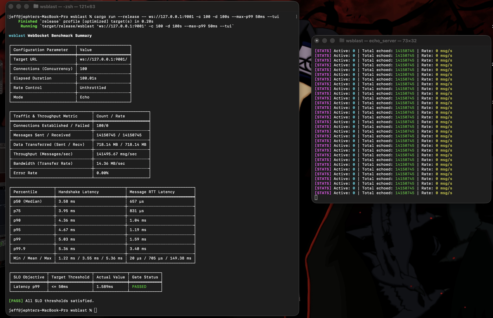

# wsblast

A high-performance WebSocket load testing CLI written in Rust.

* **Fast**: Zero-allocation hot paths and lock-free task-local metrics for maximum throughput.
* **Precise**: Monotonic microsecond latency percentiles (`p50`, `p90`, `p95`, `p99`, `p99.9`) using `HdrHistogram`.
* **CI-First**: Service Level Objective (SLO) gating with exit code `2` on budget breaches and markdown report generation.

[![Crates.io][crates-badge]][crates-url]
[![Build Status][actions-badge]][actions-url]
[![License: MIT][mit-badge]][mit-url]
[![Downloads][downloads-badge]][crates-url]

[crates-badge]: https://img.shields.io/crates/v/wsblast.svg
[crates-url]: https://crates.io/crates/wsblast
[actions-badge]: https://github.com/jephter-olamiposi/wsblast/actions/workflows/ci.yml/badge.svg
[actions-url]: https://github.com/jephter-olamiposi/wsblast/actions/workflows/ci.yml
[mit-badge]: https://img.shields.io/badge/license-MIT-blue.svg
[mit-url]: https://github.com/jephter-olamiposi/wsblast/blob/main/LICENSE
[downloads-badge]: https://img.shields.io/crates/d/wsblast.svg

## Overview

`wsblast` generates concurrent WebSocket load, measures round-trip latency distributions, and evaluates latency and error budgets in CI/CD pipelines.

Key capabilities:
* **Zero-Allocation Hot Path:** Pre-allocated frame buffers (`Utf8Bytes`, `Bytes`) avoid heap allocations in worker loops.
* **Lock-Free Concurrency:** Task-local latency histograms eliminate mutex contention across concurrent workers.
* **Connection Pacing:** Connection ramp rate (`--ramp-rate`) and request pacing (`--rate`) prevent SYN-flood queue drops and thundering-herd issues.
* **Failure Taxonomy:** Distinguishes DNS, TCP, TLS, HTTP 101 Upgrade rejection (`4xx`/`5xx`), protocol violations, timeouts, and unexpected closes.
* **Live Dashboard:** Interactive terminal UI powered by Ratatui with real-time throughput sparklines and active connection counters.
* **Scenario DSL:** Declarative YAML phases with targets, actions, think time, and per-phase pacing.
* **Production Protocols:** GraphQL WS subscriptions, JWT/OAuth2/API-key authentication, and fail-fast compression diagnostics.
* **Observability:** Live Prometheus `/metrics` scraping and OpenTelemetry OTLP export.
* **Resilience Testing:** Non-blocking chaos injection (latency, loss, corruption, forced closes) and PCAP-NG/JSONL frame capture.
* **Scale and CI:** Distributed coordinator/worker execution, baseline regression comparison, record/replay mock server, and SLO gating.
* **Multi-Format Reports:** Generates human-readable terminal tables, machine-readable JSON (schema v1.0), and GitHub Flavored Markdown.

---

## Installation

### Cargo (crates.io)
```bash
cargo install wsblast
```

### Pre-Compiled Binary (macOS & Linux)
Installs the pre-built binary for your OS and CPU architecture into `/usr/local/bin`:
```bash
curl -fsSL https://raw.githubusercontent.com/jephter-olamiposi/wsblast/main/install.sh | sh
```

### Docker
```bash
docker build -t wsblast .
docker run --rm -it wsblast wss://echo.websocket.org -c 20 -d 10s
```

### Direct Download
Standalone `.tar.gz` and `.zip` packages for Linux, macOS (Apple Silicon & Intel), and Windows are available on the [Releases](https://github.com/jephter-olamiposi/wsblast/releases) page.

---

## Quick Start

Run a 10-second test with 50 concurrent connections against an echo endpoint:
```bash
wsblast ws://127.0.0.1:9001 -c 50 -d 10s
```

Launch the interactive terminal dashboard (TUI):
```bash
wsblast ws://127.0.0.1:9001 -c 100 -d 30s --tui
```

Enforce latency and error rate budgets:
```bash
wsblast ws://127.0.0.1:9001 -c 50 -d 15s --max-p99 25ms --max-error-rate 0.01
```

---

## Feature Flags

Advanced capabilities are compiled on demand so the core binary stays small. Install everything with:

```bash
cargo install wsblast --features full
```

| Feature | Capability |
| :--- | :--- |
| `scenario` | YAML multi-phase scenarios with per-phase targets, actions, and think time |
| `otel` | OpenTelemetry OTLP metric export |
| `prometheus` | Prometheus `/metrics` HTTP endpoint |
| `auth` | Static, JWT, OAuth2, and API-key handshake authentication |
| `graphql-ws` | Apollo GraphQL WS `connection_init` / `start` subscriptions |
| `capture` | Frame capture to PCAP-NG or JSON Lines |
| `chaos` | Latency, loss, corruption, and forced-close injection |
| `compare` | Baseline/current JSON report regression gates |
| `mock` | Record/replay WebSocket mock server subcommands |
| `distributed` | Coordinator/worker gRPC execution across machines |
| `compression` | Accepted for forward compatibility; fails fast until RFC 7692 support is available |

`full` enables every feature above. The `compression` flag is intentionally not a silent no-op: `--compression` exits with a clear error until the transport stack supports permessage-deflate (see ADR-001 in the local design notes).

---

## Scenario DSL

Run a validated multi-phase scenario instead of a single fixed load:

```bash
wsblast --scenario examples/scenarios/basic.yaml --no-progress
wsblast --scenario examples/scenarios/basic.yaml --phase sustain
```

A scenario can set a default `target`, override it per phase, and override the CLI URL:

```yaml
version: "1.0"
target: "ws://127.0.0.1:9001"
metadata:
  name: "Warmup and sustain"

phases:
  - name: "warmup"
    duration: "5s"
    connections: 10
    ramp_rate: 5
    rate_per_conn: 50
    payload: '{"seq":{{seq}}}'
    think_time: "10ms"
    actions:
      - type: Send

  - name: "sustain"
    target: "ws://127.0.0.1:9002"
    duration: "30s"
    connections: 50
    rate_per_conn: 100
    actions:
      - type: Send
        count: 5
      - type: Wait
        duration: "100ms"
      - type: Ping
        interval: "2s"
```

Endpoint precedence is **CLI `--url` → phase `target` → scenario `target`**. Supported actions are `Send`, `Wait`, `Ping`, and `Close`; scripts repeat until the phase duration elapses, the run is cancelled, or `Close` executes. `think_time` pauses after each send burst. A scenario may omit its target only when `--url` is supplied.

---

## Authentication

Authentication is resolved once at startup and merged into the WebSocket handshake headers:

```bash
# Static bearer token
wsblast wss://api.example.com/ws -c 10 -d 30s \
  --auth-type static --auth-token "$TOKEN"

# API key in a custom header
wsblast wss://api.example.com/ws -c 10 -d 30s \
  --auth-type apikey --auth-apikey "$KEY" --auth-apikey-header X-API-Key

# JWT signed locally with HS256
wsblast wss://api.example.com/ws \
  --auth-type jwt \
  --auth-jwt-endpoint https://api.example.com \
  --auth-jwt-client-id load-test \
  --auth-jwt-secret "$JWT_SECRET"

# OAuth2 client-credentials exchange
wsblast wss://api.example.com/ws \
  --auth-type oauth2 \
  --auth-oauth2-token-url https://auth.example.com/token \
  --auth-oauth2-client-id "$CLIENT_ID" \
  --auth-oauth2-client-secret "$CLIENT_SECRET"
```

Static and JWT/OAuth2 tokens are not refreshed mid-run. For tests longer than the token lifetime, provide a long-lived token or a static token with an appropriate expiry. The non-functional `Custom` authenticator is rejected at startup.

---

## Observability

Both exporters are opt-in and start before load generation:

```bash
# OTLP push (default endpoint http://localhost:4317)
wsblast wss://api.example.com/ws -d 30s \
  --otel --otel-endpoint http://collector:4317 --otel-service-name wsblast-ci

# Prometheus scrape endpoint (default 0.0.0.0:9090)
wsblast wss://api.example.com/ws -d 30s \
  --prometheus --prometheus-listen 127.0.0.1:9090
curl http://127.0.0.1:9090/metrics
```

Prometheus is refreshed at scrape time, while OTLP records live deltas every 10 seconds and flushes final histograms on shutdown. Exporters are standalone-only; distributed mode rejects these flags instead of ignoring them.

---

## Chaos Injection and Frame Capture

Chaos options inject faults without blocking the async runtime. Any chaos option implicitly enables injection; percentages must be between `0` and `100`:

```bash
wsblast ws://127.0.0.1:9001 -c 20 -d 30s \
  --chaos-latency 25 --chaos-loss 1.5 --chaos-corrupt 0.5 --chaos-close 0.1
```

Capture every sent and received frame into one file shared across workers and scenario phases:

```bash
wsblast ws://127.0.0.1:9001 -c 10 -d 5s \
  --capture --capture-output run.pcapng

wsblast --scenario examples/scenarios/basic.yaml \
  --capture --capture-output run.jsonl --capture-format json-lines
```

`--capture-max-frames 0` (the default) is unlimited. PCAP-NG opens directly in Wireshark; JSON Lines is suitable for structured logs. Capture is standalone-only and rejected in distributed mode.

---

## GraphQL WS

Use the Apollo `graphql-transport-ws` protocol for subscriptions:

```bash
wsblast wss://api.example.com/graphql \
  --mode graphql-ws \
  --subprotocol graphql-transport-ws \
  --graphql-ws-operation 'subscription Prices { prices(symbol: "BTC") }' \
  --graphql-ws-operation-name Prices \
  --graphql-ws-variables '{"symbol":"BTC"}'
```

The worker performs `connection_init`, waits for `connection_ack`, sends `subscribe`, records `next` frames, answers `ping` with `pong`, and terminates on `complete` or `error`. Selecting `--subprotocol graphql-ws` switches to the legacy `start` / `data` / `stop` flow.

---

## Distributed Execution

A coordinator splits the connection budget into contiguous ranges and workers execute them over plaintext gRPC:

```bash
# Coordinator
wsblast --distributed-mode coordinator \
  --coordinator-bind 0.0.0.0:50052 \
  --worker-count 4 \
  --url wss://api.example.com/ws -c 400 -d 2m --no-progress

# Each worker
wsblast --distributed-mode worker \
  --coordinator-url http://coordinator.internal:50052 \
  --worker-id worker-1
```

Workers retry coordinator startup races, report staged metrics, and requeue abandoned ranges when a worker fails. The coordinator merges histograms and applies SLO gating with exit code `2` on a breach. Auth is resolved by the coordinator and transmitted as handshake headers; GraphQL and chaos settings are part of the wire config.

**Distributed limitations:** scenario files, frame capture, the TUI, and observability exporters are not supported in distributed mode and fail fast. Run those features standalone.

---

## Mock Server (Record/Replay)

Record a real interaction and replay it for contract tests:

```bash
wsblast mock record --bind 127.0.0.1:9001 --output session.json
wsblast mock replay --bind 127.0.0.1:9001 --input session.json --delay 5
```

Replay supports deterministic error injection:

```bash
wsblast mock replay --bind 127.0.0.1:9001 --input session.json \
  --error-close-after 10 --error-inject-after 5 --error-message "synthetic failure"
```

---

## Baseline Comparison

Archive a run as JSON, then compare a later run against it:

```bash
wsblast wss://api.example.com/ws -c 50 -d 30s --format json -o baseline.json
wsblast wss://api.example.com/ws -c 50 -d 30s --format json -o current.json

wsblast --compare baseline.json current.json \
  --compare-threshold 10 --fail-on-regression
```

`--fail-on-regression` exits with code `2` when any tracked metric regresses beyond the threshold.

---

## Architecture



---

## Terminal Dashboard (TUI)

Pass `--tui` to launch an interactive live dashboard powered by Ratatui:



---

## Benchmark Report

At completion, `wsblast` renders a percentile latency breakdown and SLO evaluation:



---

## CI/CD Pipeline Integration

`wsblast` returns exit code `2` on SLO breaches, making it suitable for CI/CD performance regression gates.

```yaml
name: Performance Gate

on: [push, pull_request]

jobs:
  websocket-gate:
    runs-on: ubuntu-latest
    steps:
      - uses: actions/checkout@v4

      - name: Install wsblast
        run: curl -fsSL https://raw.githubusercontent.com/jephter-olamiposi/wsblast/main/install.sh | sh

      - name: Run Performance Gate
        run: |
          wsblast wss://staging.example.com/ws \
            -c 50 \
            -d 15s \
            --max-p99 30ms \
            --max-error-rate 0.005 \
            --format markdown \
            --no-progress \
            -o report.md

      - name: Attach Summary to PR
        if: always()
        run: cat report.md >> $GITHUB_STEP_SUMMARY
```

---

## Command-Line Reference

```text
wsblast [OPTIONS] [URL] [COMMAND]
```

### Core Options

| Option | Default | Description |
| :--- | :--- | :--- |
| `URL`, `-u, --url` | *Required* | Target WebSocket endpoint (`ws://` or `wss://`) |
| `-c, --connections` | `50` | Number of concurrent WebSocket connection workers |
| `--ramp-rate` | `0` | Connection ramp rate in workers/sec (`0` = unthrottled burst). The ramp counts toward `--duration`; if it needs longer than the duration, a warning is printed and not every connection opens |
| `-d, --duration` | `10s` | Total wall-clock test duration including the ramp-up (e.g. `10s`, `30s`, `2m`, `500ms`) |
| `-n, --requests` | `None` | Total message limit across all workers |
| `-r, --rate` | `0` | Message rate per connection per second (`0` = unthrottled) |
| `-p, --payload` | JSON payload | Inline text payload (supports `{{timestamp}}`, `{{worker_id}}`, `{{seq}}`) |
| `--payload-file` | `None` | Path to file containing payload |
| `--binary` | `false` | Send payload as binary frames instead of text |
| `-H, --header` | `None` | Custom HTTP header (e.g. `-H "Authorization: Bearer token"`) |
| `--subprotocol` | `None` | WebSocket subprotocol (e.g. `graphql-transport-ws`) |
| `--mode` | `echo` | Execution mode: `echo` (RTT round-trip), `stream` (dispatch-only), `listen`, `graphql-ws` |
| `--connect-timeout` | `5s` | Timeout for establishing TCP+TLS+WS upgrade handshake |
| `--message-timeout` | `5s` | Per-message response timeout in echo mode |
| `--ping-interval` | `0s` | Heartbeat ping interval (`0s` = disabled) |
| `--tui` | `false` | Launch interactive terminal dashboard |
| `--format` | `text` | Output report format: `text`, `json`, `markdown` |
| `-o, --output` | `None` | File path to write report output |
| `--no-progress` | `false` | Suppress progress bar (recommended for CI logs) |

### Scenario Options

| Option | Description |
| :--- | :--- |
| `--scenario <FILE>` | YAML scenario definition; conflicts with per-run sizing/payload flags |
| `--phase <NAME>` | Execute only the named scenario phase |
| `--url` | Overrides phase and scenario targets when supplied |

### Observability Options

| Option | Description |
| :--- | :--- |
| `--otel` | Enable OpenTelemetry OTLP metric export |
| `--otel-endpoint <URL>` | OTLP collector endpoint (default `http://localhost:4317`) |
| `--otel-service-name <NAME>` | OTLP resource `service.name` (default `wsblast`) |
| `--prometheus` | Serve Prometheus metrics over HTTP |
| `--prometheus-listen <ADDR>` | Listen address for `/metrics` (default `0.0.0.0:9090`) |

### Authentication Options

| Option | Description |
| :--- | :--- |
| `--auth-type <TYPE>` | `none`, `static`, `jwt`, `oauth2`, or `apikey` |
| `--auth-token <TOKEN>` | Static token; `Authorization` values gain a `Bearer ` prefix when absent |
| `--auth-header <HEADER>` | Header for a static token (default `Authorization`) |
| `--auth-apikey <KEY>` | API key value |
| `--auth-apikey-header <HEADER>` | API-key header (default `X-API-Key`) |
| `--auth-jwt-endpoint <URL>` | JWT audience/endpoint |
| `--auth-jwt-client-id <ID>` | JWT issuer/client identifier |
| `--auth-jwt-secret <SECRET>` | HS256 signing secret |
| `--auth-jwt-scopes <SCOPE>...` | JWT scopes |
| `--auth-oauth2-token-url <URL>` | OAuth2 token endpoint |
| `--auth-oauth2-client-id <ID>` | OAuth2 client ID |
| `--auth-oauth2-client-secret <SECRET>` | OAuth2 client secret |
| `--auth-oauth2-scopes <SCOPE>...` | OAuth2 scopes |

### GraphQL WS Options

| Option | Description |
| :--- | :--- |
| `--graphql-ws-operation <QUERY>` | GraphQL query/mutation/subscription text |
| `--graphql-ws-operation-name <NAME>` | Operation name |
| `--graphql-ws-variables <JSON>` | Variables object |
| `--graphql-ws-extensions <JSON>` | Extensions object |

### Capture, Chaos, and Comparison Options

| Option | Description |
| :--- | :--- |
| `--capture` | Enable frame capture |
| `--capture-output <FILE>` | Capture destination |
| `--capture-format <FORMAT>` | `pcap-ng` (default) or `json-lines` |
| `--capture-max-frames <NUM>` | Frame cap; `0` = unlimited |
| `--chaos` | Enable chaos injection |
| `--chaos-latency <MS>` | Added latency in milliseconds |
| `--chaos-loss <PERCENT>` | Frame loss percentage (`0`–`100`) |
| `--chaos-corrupt <PERCENT>` | Frame corruption percentage (`0`–`100`) |
| `--chaos-close <PERCENT>` | Forced connection-close percentage (`0`–`100`) |
| `--compare <BASELINE> <CURRENT>` | Compare two JSON reports |
| `--compare-threshold <PERCENT>` | Regression threshold (default `10`) |
| `--fail-on-regression` | Exit `2` when the comparison detects a regression |

### Distributed Options

| Option | Description |
| :--- | :--- |
| `--distributed-mode <MODE>` | `coordinator` or `worker`; omit for standalone execution |
| `--coordinator-url <URL>` | Coordinator gRPC URL for worker mode |
| `--worker-id <ID>` | Stable worker ID (auto-generated when omitted) |
| `--worker-count <NUM>` | Number of workers the coordinator expects |
| `--worker-bind <ADDR>` | Worker gRPC bind address |
| `--coordinator-bind <ADDR>` | Coordinator gRPC bind address |

### SLO Gating Options

| Option | Description |
| :--- | :--- |
| `--max-p50 <DURATION>` | Maximum acceptable p50 (median) round-trip latency (e.g. `5ms`, `500us`) |
| `--max-p95 <DURATION>` | Maximum acceptable p95 round-trip latency (e.g. `20ms`) |
| `--max-p99 <DURATION>` | Maximum acceptable p99 round-trip latency (e.g. `50ms`) |
| `--max-p999 <DURATION>` | Maximum acceptable p99.9 round-trip latency (e.g. `100ms`) |
| `--max-error-rate <FLOAT>` | Maximum acceptable error rate fraction (e.g. `0.01` for 1%) |
| `--min-throughput <RPS>` | Minimum required message throughput (messages/sec) |

Latency budgets apply to round-trip time, which only `--mode echo` measures; other modes reject them at startup. A latency check with no measured round trips (for example, every request timed out) fails rather than passing on an empty histogram.

---

## Exit Codes

| Code | Status | Description |
| :--- | :--- | :--- |
| `0` | **Success** | Test completed successfully and all configured SLO thresholds passed. |
| `1` | **Failure** | Runtime error (unreachable host, invalid configuration, fatal I/O error). |
| `2` | **SLO Breach** | Benchmark completed, but one or more SLO thresholds were violated. |

---

## License

MIT. See [LICENSE](LICENSE).
